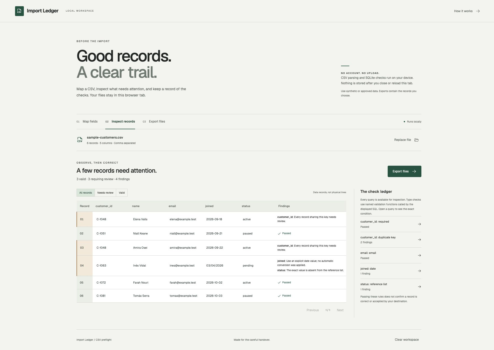

# Import Ledger

Check a CSV before handing it to an import process. Map its columns, choose explicit rules, inspect each finding and export the records with an audit of the checks.

[Open the workspace](https://stigmavlc.github.io/import-ledger/) · [Format and export reference](docs/format.md)

Import Ledger is a small browser tool for onboarding and support work. It helps answer concrete questions: which records share an identifier, which dates need a decision, and which values fall outside an agreed list? It does not connect to a customer system or claim that a destination will accept the output.



## A short walkthrough

1. Choose **Try the sample**. The six fictional customer records include a repeated identifier, an ambiguous date and a status outside the allowed list.
2. Review **Map fields**. The first column starts as required and unique. For the sample, email and date rules and an allowed status list are already set. Uploaded files start with text fields; choose the rules yourself.
3. Select **Run checks**. Three sample records pass. The other three have four findings. Select a query to see the SQL and its bound parameters.
4. Inspect the records. Change the third record's identifier to `C-1099`. Change record four's date to `2026-04-03` and status to `active` only if those are the intended values. These are explicit example decisions, not values the tool can infer.
5. Run the checks again. All six pass. Download the valid CSV, the rejected CSV and the JSON audit from **Export files**.

The [sample files](public/samples/) include a valid list, records needing review and a structurally broken CSV. They contain fictional people and reserved example email addresses. Download a file from GitHub's raw view to try the upload flow. A file upload does not infer the sample's validation rules.

## What the workspace does

- Parses quoted delimiters, multiline fields, Unicode, a UTF-8 byte order mark and common CSV delimiters.
- Maps source columns to named target fields. An optional unmapped field produces an empty value; a required field must be mapped.
- Checks required values, explicit types, duplicate keys and exact reference-list membership in an in-memory SQLite database.
- Shows the generated SQL alongside its finding count. Duplicate checks use `GROUP BY` and `HAVING`; reference checks use a `LEFT JOIN`.
- Lets a person correct a whole record in a dialog. Any mapping or record change invalidates the earlier result and disables export until checks run again.
- Keeps the original source fingerprint, mapping, findings, SQL and before/after edits in the audit manifest.

## Data and privacy

CSV contents remain in the current tab's memory. Parsing, hashing and SQLite validation happen on the device. There is no application server, telemetry, account, local storage, session storage or background synchronisation. Fonts and the SQLite WebAssembly file are served with the application. The hosting provider still handles ordinary page and asset requests; browser extensions can have their own access.

Reloading or closing the tab discards the workspace. Downloads remain wherever the browser saves them. Both CSV exports and the audit can contain personal information: the rejected file retains all source columns, and the manifest includes exact edits and reference values. Use synthetic data or data you are authorised to process and share exports carefully. This tool does not anonymise records.

## Run locally

Use Node.js 22.12 or later and npm. The lockfile pins the dependency tree.

```sh
npm ci
npm run dev
```

Open the local URL printed by Vite. To create a static release:

```sh
npm run build
```

The `dist/` directory can be served by a static HTTPS host. Web Crypto needs a secure context, such as HTTPS or localhost. Relative asset paths allow the GitHub Pages project URL.

## Checks

```sh
npm test
npm run build
npx playwright install chromium
npm run test:browser
```

Unit tests cover CSV structure, quoting, Unicode, type ambiguity, blank values, duplicate groups, reference membership, SQL parameter separation, escaping, deterministic exports and edit history. Browser tests cover importing, inspecting queries, repairing records, downloading files, invalid UTF-8, malformed input, the absence of application persistence and mobile containment. GitHub Actions runs the same checks, then publishes the built output to Pages.

The tests demonstrate this scope on synthetic examples. They do not establish compatibility with every spreadsheet or third-party import system.

## How it is organised

`src/ledger.ts` contains parsing, rules, SQLite checks and serialisation. Data values use prepared statements; target labels never become SQL identifiers. `src/App.tsx` owns the current workspace, record editor and downloads. React renders imported text as text. `tests/workspace.spec.ts` exercises the browser workflow.

The application is a static React and TypeScript build using Vite, Papa Parse and sql.js. SQLite exists only for a check run and is closed afterwards. It is useful evidence of a bounded local validation workflow, not a production database service.

## Limits

Files must be valid UTF-8 with one header row, at least one record, no more than 1,000,000 bytes, 5,000 data records and 60 columns. Every row must have the same width and source headers must be non-empty and distinct. This is intentionally a small-file tool, not a streaming importer.

No automatic date conversion, trimming, deduplication, key generation, fuzzy matching, destination schema lookup or live import occurs. There are no cross-file joins, composite keys, saved mappings, XLSX support or arbitrary SQL editor. A reference list can contain at most 500 values per field. Each unique key is checked separately. A passing record satisfies only the rules chosen here.

CSV export protects formula prefixes by adding an apostrophe, including to negative-looking numbers. That is an explicit export transformation and can affect the receiving application's interpretation. Review the [format reference](docs/format.md) before importing an exported file.

## Licence

MIT, copyright Ivan Aguilar. See [LICENSE](LICENSE) and [third-party notices](THIRD_PARTY_NOTICES.md).
